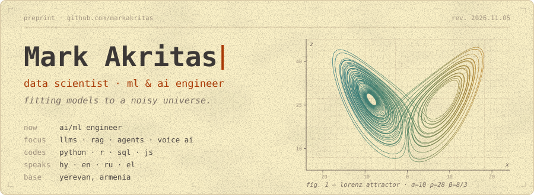
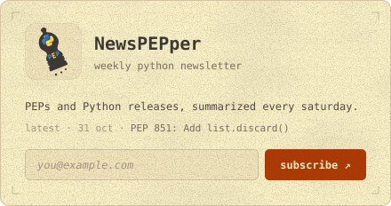
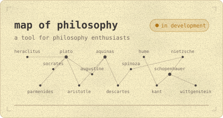
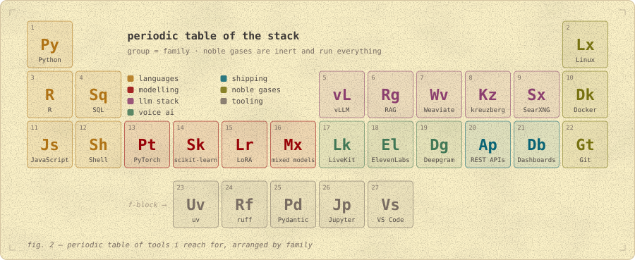
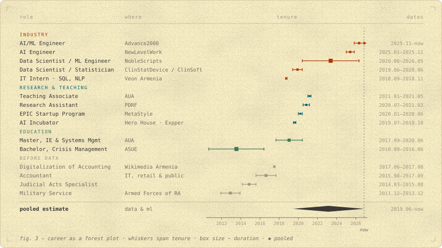
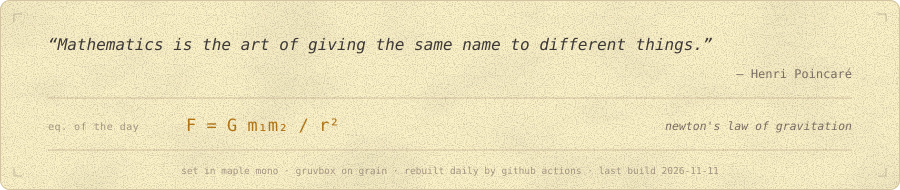

<picture>
  <source media="(prefers-color-scheme: dark)" srcset="assets/header-dark.svg">
  
</picture>

  <a href="mailto:markakrita@gmail.com"><picture><source media="(prefers-color-scheme: dark)" srcset="assets/chip-mail-dark.svg"></picture></a>&nbsp;
  <a href="https://markakritas.github.io"><picture><source media="(prefers-color-scheme: dark)" srcset="assets/chip-web-dark.svg"></picture></a>

### <samp>§0 &nbsp;abstract</samp>

<samp>Data scientist and ML/AI engineer. Working with data since 2019: experiment design and mixed-effects models, ML pipelines and signal processing, now LLMs: fine-tuning, RAG, agents and voice AI. Master's in industrial engineering; before that, crisis management and accounting. Interests: music, history, science & philosophy.</samp>

### <samp>§1 &nbsp;projects</samp>

  <a href="https://newspepper.dev/#subscribe-email"><picture><source media="(prefers-color-scheme: dark)" srcset="assets/newspepper-dark.svg"></picture></a>
  <picture><source media="(prefers-color-scheme: dark)" srcset="assets/philosophy-dark.svg"></picture>

  <a href="https://marketplace.visualstudio.com/items?itemName=markakritas.jumpwise"><picture><source media="(prefers-color-scheme: dark)" srcset="assets/jumpwise-dark.svg"></picture></a>

### <samp>§2 &nbsp;methods</samp>

<picture>
  <source media="(prefers-color-scheme: dark)" srcset="assets/stack-dark.svg">
  
</picture>

### <samp>§3 &nbsp;trajectory</samp>

<picture>
  <source media="(prefers-color-scheme: dark)" srcset="assets/career-dark.svg">
  
</picture>

<samp>plain-text version</samp>

 

| <samp>when</samp>            | <samp>role</samp>                                                | <samp>where</samp>                                  | <samp>notes</samp>                                                                                              |
| :--------------------------- | :--------------------------------------------------------------- | :-------------------------------------------------- | :-------------------------------------------------------------------------------------------------------------- |
| <samp>2025.11–now</samp>     | <samp>**AI/ML Engineer**</samp>                                  | <samp>Advance2000</samp>                            | <samp>LoRA fine-tuning · private assistant with web search, RAG & agents · voice agents for call centers</samp> |
| <samp>2025.01–2025.11</samp> | <samp>**AI Engineer**</samp>                                     | <samp>NewLevelWork</samp>                           | <samp>LLM & voice chatbots · agentic workflows · RAG · document parsing · REST APIs</samp>                      |
| <samp>2020.06–2026.05</samp> | <samp>**Data Scientist / ML Engineer**</samp>                    | <samp>NobleScripts</samp>                           | <samp>research · ML · signal processing · pipelines · deployment</samp>                                         |
| <samp>2019.06–2020.06</samp> | <samp>**Data Scientist / Statistician**</samp>                   | <samp>ClinStatDevice / ClinSoft</samp>              | <samp>design of experiments · randomization · simulation · mixed-effects models · dashboards</samp>             |
| <samp>2021.01–2021.05</samp> | <samp>Teaching Associate</samp>                                  | <samp>AUA</samp>                                    | <samp>Programming for Data Science (Python & R)</samp>                                                          |
| <samp>2020.07–2021.03</samp> | <samp>Research Assistant</samp>                                  | <samp>PDRF</samp>                                   | <samp>skill-mismatch research · survey design · analysis</samp>                                                 |
| <samp>2020.01–2020.06</samp> | <samp>EPIC Startup Program</samp>                                | <samp>MetaStyle</samp>                              | <samp>text style transfer with ML</samp>                                                                        |
| <samp>2019.07–2019.10</samp> | <samp>AI Incubator</samp>                                        | <samp>Hero House · Expper</samp>                    | <samp>human–robot interaction · emotional response prototyping</samp>                                           |
| <samp>2018.09–2018.11</samp> | <samp>IT Intern</samp>                                           | <samp>Veon Armenia</samp>                           | <samp>SQL reports · NLP</samp>                                                                                  |
| <samp>2017.09–2020.06</samp> | <samp>Master, Industrial Engineering & Systems Management</samp> | <samp>American University of Armenia</samp>         | <samp>data analytics · anomaly localization in networks</samp>                                                  |
| <samp>2010.09–2016.06</samp> | <samp>Bachelor, Crisis Management</samp>                         | <samp>Armenian State University of Economics</samp> | <samp>thesis: spatial development in Armenia</samp>                                                             |

 

<picture>
  <source media="(prefers-color-scheme: dark)" srcset="assets/footer-dark.svg">
  
</picture>
